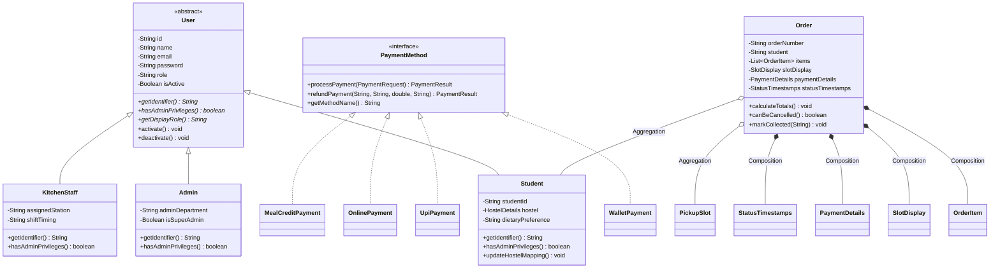

# Object-Oriented Programming (OOPS) Concepts in BiteSync

This document maps every core Object-Oriented Programming (OOPS) principle and design pattern directly to its real-world production implementation inside the **BiteSync Java 21 + Spring Boot** backend (`backend/src/main/java/com/bitesync/`).

No isolated toy classes are used—every concept drives real hostel canteen workflows including student pre-ordering, wallet management, slot capacity control, polymorphic payments, coupon discounts, and anti-duplicate QR meal collection.

---

## Architecture & Class Hierarchy Overview



---

## 1. Encapsulation

### Definition
Encapsulation bundles an object's data (fields) and the methods that operate on that data into a single unit (class), restricting direct outside mutation through `private` fields and enforcing business invariants through controlled domain methods.

### Implementation Locations
- `Wallet` — `backend/src/main/java/com/bitesync/model/wallet/Wallet.java`
- `PickupSlot` — `backend/src/main/java/com/bitesync/model/slot/PickupSlot.java`
- `MenuItem` — `backend/src/main/java/com/bitesync/model/menu/MenuItem.java`
- `Order` — `backend/src/main/java/com/bitesync/model/order/Order.java`
- `InventoryItem` — `backend/src/main/java/com/bitesync/model/inventory/InventoryItem.java`

### Code Snippets from BiteSync

**Wallet balance protection (`Wallet.java`):**
```java
@Document(collection = "wallets")
public class Wallet {
    private Double balance = 500.0;
    private Boolean isActive = true;

    public boolean hasSufficientBalance(double requiredAmount) {
        return Boolean.TRUE.equals(this.isActive) && this.balance != null && this.balance >= requiredAmount;
    }

    public void credit(double amount) {
        if (amount <= 0) {
            throw new IllegalArgumentException("Credit amount must be greater than zero.");
        }
        if (this.balance == null) this.balance = 0.0;
        this.balance += amount;
    }

    public void deduct(double amount) {
        if (!hasSufficientBalance(amount)) {
            throw new IllegalStateException("Insufficient wallet balance. Available: ₹"
                    + this.balance + ", Required: ₹" + amount);
        }
        this.balance -= amount;
    }

    public void setBalance(Double balance) {
        if (balance != null && balance < 0) {
            throw new IllegalArgumentException("Wallet balance cannot be negative.");
        }
        this.balance = balance;
    }
}
```

**Slot capacity invariant (`PickupSlot.java`):**
```java
public boolean hasAvailableCapacity() {
    return !Boolean.TRUE.equals(this.isClosed)
            && (this.currentBookings == null || this.currentBookings < this.maxCapacity);
}

public void bookSlot() {
    if (!hasAvailableCapacity()) {
        throw new IllegalStateException("Slot " + startTime + "-" + endTime + " is full or closed.");
    }
    this.currentBookings = (this.currentBookings != null ? this.currentBookings : 0) + 1;
}
```

**Automatic sold-out transition (`MenuItem.java`):**
```java
public void deductStock(int quantity) {
    if (!hasAvailableStock(quantity)) {
        throw new IllegalStateException("Insufficient stock for dish: " + this.name);
    }
    this.stockQuantity -= quantity;
    if (this.stockQuantity <= 0) {
        this.stockQuantity = 0;
        this.isAvailable = false;
    }
}
```

### Why It Is Used in BiteSync
- Guarantees a student's wallet can **never** drop below ₹0 or be credited with negative values.
- Ensures a 15-minute pickup slot can **never** be overbooked beyond `maxCapacity` or booked while closed.
- Automatically flips `MenuItem.isAvailable` to `false` the moment the last portion sells out.
- Prevents `Order.markCollected()` from stamping the same order twice.

### How to Explain in Viva
> "In BiteSync, encapsulation isn't just getters and setters—it protects critical business invariants. For example, `Wallet.balance` is `private`, and callers use `credit()` and `deduct()`, which validate non-negative balances and active wallet status inside the entity itself. Similarly, `PickupSlot.bookSlot()` refuses bookings once `currentBookings == maxCapacity` or `isClosed == true`."

---

## 2. Inheritance

### Definition
Inheritance allows a specialized subclass (`IS-A` relationship) to inherit common fields and behaviors from a parent base class, promoting code reuse and hierarchical domain modeling.

### Implementation Locations
- Base abstract class: `User` — `backend/src/main/java/com/bitesync/model/user/User.java`
- Subclasses:
  - `Student` — `backend/src/main/java/com/bitesync/model/user/Student.java`
  - `Admin` — `backend/src/main/java/com/bitesync/model/user/Admin.java`
  - `KitchenStaff` — `backend/src/main/java/com/bitesync/model/user/KitchenStaff.java`
- Exception hierarchy: `BiteSyncException` extended by 8 custom domain exceptions in `backend/src/main/java/com/bitesync/exception/`.

### Code Snippet from BiteSync
```java
// Base Class (User.java)
@Document(collection = "users")
public abstract class User {
    @Id
    private String id;
    private String name;
    private String email;
    private String password;
    private String role;
    private Boolean isActive = true;

    public abstract String getIdentifier();
    public abstract boolean hasAdminPrivileges();
    public abstract String getDisplayRole();
}

// Concrete Subclass (Student.java)
public class Student extends User {
    private String studentId;
    private HostelDetails hostel;
    private String dietaryPreference = "all";

    public Student(String name, String email, String password, String studentId, HostelDetails hostel) {
        super(name, email, password, "student");
        this.studentId = studentId != null ? studentId.toUpperCase() : null;
        this.hostel = hostel != null ? hostel : new HostelDetails();
    }
}
```

### Why It Is Used in BiteSync
Students, Canteen Admins, and Kitchen Staff all share authentication credentials (`email`, `password`, `isActive`), audit timestamps, and Spring Security integration, while possessing distinct domain attributes (`studentId`/`hostel` vs `adminDepartment` vs `assignedStation`/`shiftTiming`). All three persist cleanly into MongoDB's single `users` collection via `MongoConfig.UserReadConverter` and `UserWriteConverter`.

### How to Explain in Viva
> "BiteSync has three distinct user roles that share authentication and lifecycle behavior. Rather than duplicating fields across three classes or polluting one giant class with nullable fields, we modeled `User` as an abstract base class and created `Student`, `Admin`, and `KitchenStaff` subclasses using `extends` and `super(...)` constructor chaining."

---

## 3. Abstraction

### Definition
Abstraction hides internal implementation complexity behind clean contracts (abstract classes and interfaces), exposing only *what* an object does rather than *how* it does it.

### Implementation Locations
- Abstract Class: `User` — `backend/src/main/java/com/bitesync/model/user/User.java`
- Interfaces:
  - `PaymentMethod` — `backend/src/main/java/com/bitesync/interfaces/PaymentMethod.java`
  - `DiscountStrategy` — `backend/src/main/java/com/bitesync/interfaces/DiscountStrategy.java`
  - `OrderProcessor` — `backend/src/main/java/com/bitesync/interfaces/OrderProcessor.java`
  - `NotificationService` — `backend/src/main/java/com/bitesync/interfaces/NotificationService.java`

### Code Snippet from BiteSync
```java
public interface PaymentMethod {
    PaymentResult processPayment(PaymentRequest request);
    PaymentResult refundPayment(String studentId, String transactionId, double amount, String orderNumber);
    String getMethodName();
}
```

### Why It Is Used in BiteSync
`OrderService` does not need to know how a Wallet checks MongoDB ledger balances, how UPI validates Virtual Payment Addresses, or how Online Gateways create checkout tokens. It simply calls `paymentMethod.processPayment(request)`. Likewise, `User` is `abstract` so no generic, role-less `new User()` object can ever be instantiated.

### How to Explain in Viva
> "We used both forms of abstraction in Java: an `abstract class` (`User`) where subclasses share state and partial implementation, and `interface`s (`PaymentMethod`, `DiscountStrategy`, `NotificationService`) to define pure behavioral contracts for unrelated service implementations."

---

## 4. Polymorphism (Runtime & Compile-Time)

### Definition
Polymorphism ("many forms") allows a single interface or method call to behave differently depending on the runtime object type (Dynamic Dispatch / Runtime Polymorphism) or argument list (Compile-Time Polymorphism).

### Implementation Locations
- Runtime Payment Dispatch:
  - `PaymentFactory` — `backend/src/main/java/com/bitesync/payment/PaymentFactory.java`
  - `OrderService` — `backend/src/main/java/com/bitesync/service/OrderService.java`
- Runtime Discount Dispatch:
  - `DiscountFactory` — `backend/src/main/java/com/bitesync/discount/DiscountFactory.java`
- Runtime User Deserialization & Privilege Dispatch:
  - `MongoConfig.UserReadConverter` — `backend/src/main/java/com/bitesync/config/MongoConfig.java`

### Code Snippet from BiteSync
```java
// OrderService.java — Runtime Polymorphism in Checkout
PaymentMethod method = paymentFactory.getPaymentMethod(paymentMethod);
PaymentRequest payReq = new PaymentRequest(
        studentId, finalAmount, orderNumber, "Meal Order #" + orderNumber, paymentMethod
);
// Dynamic dispatch: invokes WalletPayment, UpiPayment, OnlinePayment, or MealCreditPayment at runtime!
PaymentResult payResult = method.processPayment(payReq);
```

```java
// OrderService.java — Runtime Polymorphism in Cancellation Refunds
PaymentMethod method = paymentFactory.getPaymentMethod(order.getPaymentMethod());
method.refundPayment(order.getStudent(), order.getPaymentDetails().getTransactionId(),
        order.getFinalAmount(), order.getOrderNumber());
```

### Why It Is Used in BiteSync
Adding a new payment rail (e.g., Campus Smart Card or Razorpay) requires creating **zero** `if/else` changes in `OrderService`. Simply adding a new `@Component` class implementing `PaymentMethod` automatically registers it into `PaymentFactory`'s `Map<String, PaymentMethod>` via Spring Dependency Injection—satisfying the **Open/Closed Principle (OCP)**.

### How to Explain in Viva
> "In `OrderService`, the reference variable type is the interface `PaymentMethod`. At runtime, `PaymentFactory` supplies a `WalletPayment`, `UpiPayment`, `OnlinePayment`, or `MealCreditPayment` instance based on what the student chose at checkout. When `method.processPayment(payReq)` executes, the JVM uses dynamic method dispatch to run the right implementation without `OrderService` knowing the concrete class."

---

## 5. Method Overloading (Compile-Time Polymorphism)

### Definition
Method overloading defines multiple methods with the **same name** in the same class, differentiated by parameter count or parameter types, resolved by the compiler at compile time.

### Implementation Locations
- `OrderService.placeOrder(...)` — `backend/src/main/java/com/bitesync/service/OrderService.java`
- `WalletService.credit(...)` — `backend/src/main/java/com/bitesync/service/WalletService.java`
- `ApiResponse.success(...)` — `backend/src/main/java/com/bitesync/dto/ApiResponse.java`

### Code Snippet from BiteSync
```java
// OrderService.java

// Overload 1: Quick express order (defaults to wallet, no slot/coupon)
public Order placeOrder(String studentId, List<OrderDtos.CartItemDto> items) {
    return placeOrder(studentId, items, null, "wallet", null, "Express Order");
}

// Overload 2: Standard pre-order with pickup slot (defaults to wallet)
public Order placeOrder(String studentId, List<OrderDtos.CartItemDto> items, String pickupSlotId) {
    return placeOrder(studentId, items, pickupSlotId, "wallet", null, null);
}

// Overload 3: Full checkout with payment method, coupon code, and notes
public Order placeOrder(String studentId, List<OrderDtos.CartItemDto> items,
                        String pickupSlotId, String paymentMethod, String couponCode, String notes) {
    ...
}
```

```java
// WalletService.java

// Overload 1: Quick top-up with auto-generated description & reference ID
public WalletTransaction credit(String studentId, double amount) {
    return credit(studentId, amount, "Wallet Top-up", "TOP-" + System.currentTimeMillis());
}

// Overload 2: Detailed credit with custom audit metadata
public WalletTransaction credit(String studentId, double amount, String description, String referenceId) {
    ...
}
```

### Why It Is Used in BiteSync
Provides ergonomic, clean service APIs for callers with different levels of checkout detail (quick express orders vs full coupon-and-slot checkouts; quick wallet recharges vs referenced refunds) while delegating to a single canonical implementation to prevent duplicated logic.

### How to Explain in Viva
> "We overloaded `placeOrder` in `OrderService` with 2, 3, and 6 parameters, and `credit` in `WalletService` with 2 and 4 parameters. The shorter overloads chain into the full method with sensible defaults, keeping the service API clean while maintaining a single source of truth."

---

## 6. Method Overriding

### Definition
Method overriding occurs when a subclass provides its own concrete implementation of a method declared in its superclass or interface, annotated with `@Override`.

### Implementation Locations
- `Student`, `Admin`, `KitchenStaff` overriding `User.getIdentifier()`, `User.hasAdminPrivileges()`, and `User.getDisplayRole()`.
- `WalletPayment`, `UpiPayment`, `OnlinePayment`, `MealCreditPayment` overriding `PaymentMethod.processPayment()`, `refundPayment()`, and `getMethodName()`.
- `PercentageDiscountStrategy`, `HostelOfferDiscountStrategy`, `FixedDiscountStrategy` overriding `DiscountStrategy` methods.

### Code Snippet from BiteSync
```java
// Student.java
@Override
public String getIdentifier() { return studentId != null ? studentId : getEmail(); }

@Override
public boolean hasAdminPrivileges() { return false; }

@Override
public String getDisplayRole() { return "Hostel Student"; }

// Admin.java
@Override
public String getIdentifier() { return "ADMIN-" + getEmail(); }

@Override
public boolean hasAdminPrivileges() { return true; }

@Override
public String getDisplayRole() { return "Canteen Administrator"; }
```

### Why It Is Used in BiteSync
Allows any component holding a generic `User` reference (such as authentication responses, user lists, or security checks) to ask `user.hasAdminPrivileges()` or `user.getDisplayRole()` and receive role-accurate behavior automatically.

### How to Explain in Viva
> "Method overriding lets each concrete `User` subclass define role-specific identity and privilege behavior while conforming to the base `User` contract. Using `@Override` ensures compiler verification that the method signature matches the parent."

---

## 7. Interfaces

### Definition
An interface defines a 100% abstract contract of methods that implementing classes must fulfill, enabling multiple inheritance of type and loose coupling between layers.

### Implementation Locations
- `PaymentMethod` (`backend/src/main/java/com/bitesync/interfaces/PaymentMethod.java`) → `WalletPayment`, `UpiPayment`, `OnlinePayment`, `MealCreditPayment`
- `DiscountStrategy` (`backend/src/main/java/com/bitesync/interfaces/DiscountStrategy.java`) → `PercentageDiscountStrategy`, `HostelOfferDiscountStrategy`, `FixedDiscountStrategy`
- `NotificationService` (`backend/src/main/java/com/bitesync/interfaces/NotificationService.java`) → `NotificationServiceImpl`
- `OrderProcessor` (`backend/src/main/java/com/bitesync/interfaces/OrderProcessor.java`)
- Spring Data Repositories (`UserRepository`, `OrderRepository`, etc. extending `MongoRepository<T, String>`)

### Why It Is Used in BiteSync
Decouples high-level business workflows (`OrderService`, `KitchenService`) from low-level details (how notifications are persisted/sent, how payments are settled, how coupons are calculated), making unit testing and future extensibility effortless.

### How to Explain in Viva
> "We use interfaces to adhere to the Dependency Inversion Principle—services depend on abstractions like `PaymentMethod` and `DiscountStrategy` rather than concrete classes."

---

## 8. Composition vs Aggregation

### Definition
- **Composition (Strong "owns-a" / Part-Of):** Child objects cannot meaningfully exist independently of the parent; their lifecycle is bound to the parent.
- **Aggregation (Weak "has-a" / Associated-With):** Referenced objects exist independently even if the referencing object is deleted.

### Implementation Locations
- **Composition** in `Order` (`backend/src/main/java/com/bitesync/model/order/Order.java`):
  - `List<OrderItem> items` (embedded line items)
  - `SlotDisplay slotDisplay` (embedded snapshot of slot timing)
  - `PaymentDetails paymentDetails` (embedded transaction receipt)
  - `StatusTimestamps statusTimestamps` (embedded lifecycle timestamps)
- **Composition** in `Student` (`backend/src/main/java/com/bitesync/model/user/Student.java`):
  - `HostelDetails hostel`
- **Aggregation** in `Order` & `Wallet` & `MenuItem`:
  - `Order.student` references an independent `Student` document ID
  - `Order.pickupSlot` references an independent `PickupSlot` document ID
  - `Wallet.student` links a `Wallet` to a `Student`
  - `MenuItem.recipeIngredients` (`RecipeIngredient`) references independent `InventoryItem` records

### Code Snippet from BiteSync
```java
@Document(collection = "orders")
public class Order {
    // AGGREGATION: Student & PickupSlot exist independently of this Order
    private String student;
    private String pickupSlot;

    // COMPOSITION: Embedded value objects owned exclusively by this Order
    private List<OrderItem> items = new ArrayList<>();
    private SlotDisplay slotDisplay = new SlotDisplay();
    private PaymentDetails paymentDetails = new PaymentDetails();
    private StatusTimestamps statusTimestamps = new StatusTimestamps();
}
```

### Why It Is Used in BiteSync
If an `Order` is deleted, its `OrderItem` snapshots and `StatusTimestamps` disappear with it (Composition), whereas the `Student` who placed the order and the `PickupSlot` time window continue to exist independently (Aggregation).

### How to Explain in Viva
> "In BiteSync, `Order` has a **composition** relationship with `OrderItem`, `PaymentDetails`, and `StatusTimestamps`—they are embedded directly inside the order document and have no standalone lifecycle. Conversely, `Order` has an **aggregation** relationship with `Student` and `PickupSlot`—deleting an order does not delete the student or the pickup slot."

---

## 9. Exception Handling

### Definition
Structured error handling using a domain-specific custom exception hierarchy combined with centralized interception so controllers stay clean and API clients receive consistent HTTP status codes and JSON payloads.

### Implementation Locations
- Base Exception: `BiteSyncException` — `backend/src/main/java/com/bitesync/exception/BiteSyncException.java`
- Domain Exceptions:
  - `OrderNotFoundException` (`404 Not Found`)
  - `ResourceNotFoundException` (`404 Not Found`)
  - `UnauthorizedActionException` (`403 Forbidden`)
  - `InsufficientBalanceException` (`400 Bad Request`)
  - `SlotFullException` (`400 Bad Request`)
  - `FoodUnavailableException` (`400 Bad Request`)
  - `PaymentFailedException` (`400 Bad Request`)
  - `DuplicateCollectionException` (`400 Bad Request` + `isDuplicate: true`)
  - `CancellationExpiredException` (`400 Bad Request`)
- Centralized Handler: `GlobalExceptionHandler` (`@RestControllerAdvice`) — `backend/src/main/java/com/bitesync/exception/GlobalExceptionHandler.java`

### Code Snippet from BiteSync
```java
@RestControllerAdvice
public class GlobalExceptionHandler {

    @ExceptionHandler(DuplicateCollectionException.class)
    public ResponseEntity<ApiResponse<Object>> handleDuplicate(DuplicateCollectionException ex) {
        return ResponseEntity.status(HttpStatus.BAD_REQUEST)
                .body(ApiResponse.duplicate(ex.getMessage(), ex.getOrder()));
    }

    @ExceptionHandler({
            InsufficientBalanceException.class,
            SlotFullException.class,
            FoodUnavailableException.class,
            PaymentFailedException.class,
            CancellationExpiredException.class
    })
    public ResponseEntity<ApiResponse<Void>> handleBusinessRuleExceptions(BiteSyncException ex) {
        return ResponseEntity.status(HttpStatus.BAD_REQUEST)
                .body(ApiResponse.error(ex.getMessage()));
    }
}
```

### Why It Is Used in BiteSync
Prevents duplicated `try/catch` blocks across 14 REST controllers. Also enables transactional-like rollback in `OrderService.placeOrder()`—if a `FoodUnavailableException` or `PaymentFailedException` is thrown mid-checkout, the `catch` block immediately releases the reserved `PickupSlot` before rethrowing the domain exception to `GlobalExceptionHandler`.

### How to Explain in Viva
> "We built a custom unchecked exception hierarchy rooted at `BiteSyncException`. Services throw expressive domain exceptions like `SlotFullException` or `DuplicateCollectionException`, and `@RestControllerAdvice` in `GlobalExceptionHandler` intercepts them globally to return standardized `ApiResponse` JSON with exact HTTP status codes."

---

## 10. Collections, Generics & Design Patterns

### Collections & Generics
- **Generic Response Wrapper (`ApiResponse<T>`)** — `backend/src/main/java/com/bitesync/dto/ApiResponse.java`: Provides compile-time type safety for all REST endpoints (`ResponseEntity<ApiResponse<Order>>`, `ResponseEntity<ApiResponse<List<MenuItem>>>`).
- **`Map<String, PaymentMethod>`** (`HashMap`) in `PaymentFactory`: $O(1)$ runtime dispatch by payment method key.
- **`List<DiscountStrategy>`** (`ArrayList`) in `DiscountFactory`: Ordered evaluation of coupon strategies.
- **`Map<String, Object>`** and **`List<Map<String, Object>>`** in `AnalyticsService` & `KitchenService`: Aggregating kitchen prep sheets, 7-day revenue trends, and dish demand forecasts.
- **`Optional<T>`** in all Spring Data repositories (`findById`, `findByEmail`, `findByPickupToken`): Eliminates `NullPointerException` via functional `.orElseThrow(...)` and `.ifPresent(...)`.

### Design Patterns Used
1. **Factory Pattern (`PaymentFactory`, `DiscountFactory`)**
   - Centralizes strategy selection without exposing concrete implementation classes to `OrderService`.
2. **Strategy Pattern (`PaymentMethod`, `DiscountStrategy`)**
   - Encapsulates interchangeable payment processing and coupon discount algorithms (`BITESYNC10`, `HOSTEL20`, `FLAT25`).
3. **Layered Architecture (Controller → Service → Repository)**
   - Strict separation of HTTP transport (`controller/`), business rules (`service/`), and MongoDB persistence (`repository/`).
4. **DTO Pattern (`dto/`)**
   - Decouples API request/response schemas (`AuthDtos`, `OrderDtos`, `MenuDtos`, `WalletDtos`) from internal MongoDB `@Document` models so sensitive fields like hashed passwords are never leaked.
